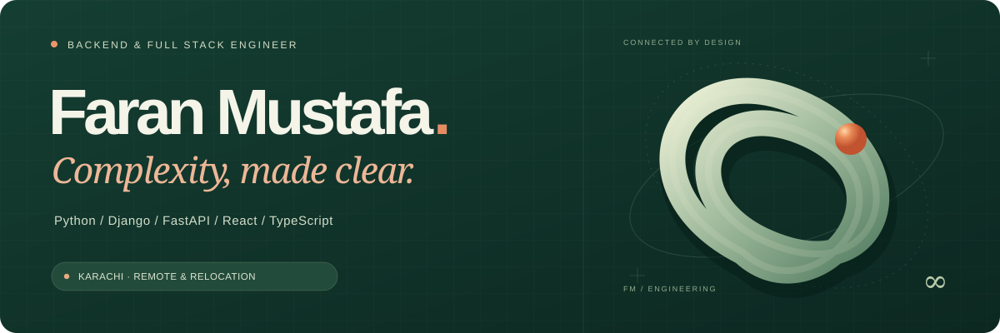
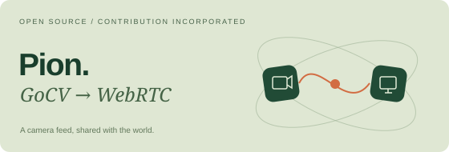
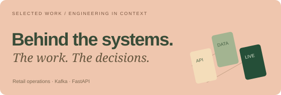

  

  <strong>Python APIs &nbsp;·&nbsp; Event-driven systems &nbsp;·&nbsp; Full-stack products</strong>

  <a href="https://faranmustafa.github.io/Portfolio/"><strong>Explore my portfolio ↗</strong></a>
  &nbsp;&nbsp; / &nbsp;&nbsp;
  <a href="https://www.linkedin.com/in/faranmustafa/">LinkedIn</a>
  &nbsp;&nbsp; / &nbsp;&nbsp;
  <a href="mailto:faran.mustafa.dev@gmail.com">Email me</a>
  &nbsp;&nbsp; / &nbsp;&nbsp;
  <a href="https://faranmustafa.github.io/Portfolio/assets/Faran-Mustafa-Resume.pdf">Résumé ↓</a>

 

## Reliable systems. Useful software.

I'm **Faran**, a backend and full-stack engineer based in **Karachi, Pakistan**, building production software since 2019.

I work across **Python services, Kafka processing and recovery, real-time communication, and retail POS/ERP applications**. I like understanding the whole system—from service boundaries and event delivery to the interface someone uses every day.

**Open to senior backend and full-stack opportunities with remote teams, and to relocation.**

 

## Work worth a closer look

<table>
<tr>
<td width="50%" valign="top">

### An example for the Pion ecosystem

Contributed a **GoCV-to-WebRTC example** that was incorporated into Pion's examples repository through a separate maintainer PR.

[Original contribution ↗](https://github.com/pion/webrtc/pull/3099) · [Maintainer confirmation ↗](https://github.com/pion/webrtc/pull/3099#issuecomment-3263048458) · [Merged example ↗](https://github.com/pion/example-webrtc-applications/pull/370)

</td>
<td width="50%" valign="top">

### The engineering behind the work

Explore illustrated case studies covering **POS transaction capture, device operations, Kafka recovery, and migration to FastAPI services**—with my contribution explained.

[Explore selected work ↗](https://faranmustafa.github.io/Portfolio/#work)

</td>
</tr>
</table>

 

## Where I contribute

| Focus | Selected professional work |
| :--- | :--- |
| **Backend reliability** | Kafka partitioning, batching, consumer concurrency, idempotent processing, retries, backoff, and dead-letter handling. |
| **Python services** | Django REST Framework APIs and decomposition of a monolith into FastAPI services. |
| **Retail operations** | POS transaction-capture agents, debugging and update management, daily-entry and EDI automation, and Django/React POS/ERP workflows. |
| **Real-time systems** | WebRTC services, WebSocket signaling, and Redis-backed features. |
| **Team delivery** | Requirements, implementation, testing, deployment, production support, mentoring, and code reviews. |

 

## My working toolkit

| Backend | Frontend | Data & messaging | Delivery & real time |
| :--- | :--- | :--- | :--- |
| Python | React | PostgreSQL | AWS |
| Django / DRF | TypeScript | Kafka | Docker |
| FastAPI | Next.js | Redis | GitHub Actions |
| Node.js | JavaScript | SQL | WebRTC / WebSockets |

**Also public:** [Next.js authentication starter ↗](https://github.com/FaranMustafa/next-auth-ts-boilerplate) — a TypeScript/NextAuth demonstration of credentials login, sessions, and token-refresh logic.

 

---

  <strong>Have a system to build—or a good problem to solve?</strong>  
  <a href="mailto:faran.mustafa.dev@gmail.com">Let's talk ↗</a>
  &nbsp;·&nbsp;
  <a href="https://faranmustafa.github.io/Portfolio/">See the work ↗</a>

